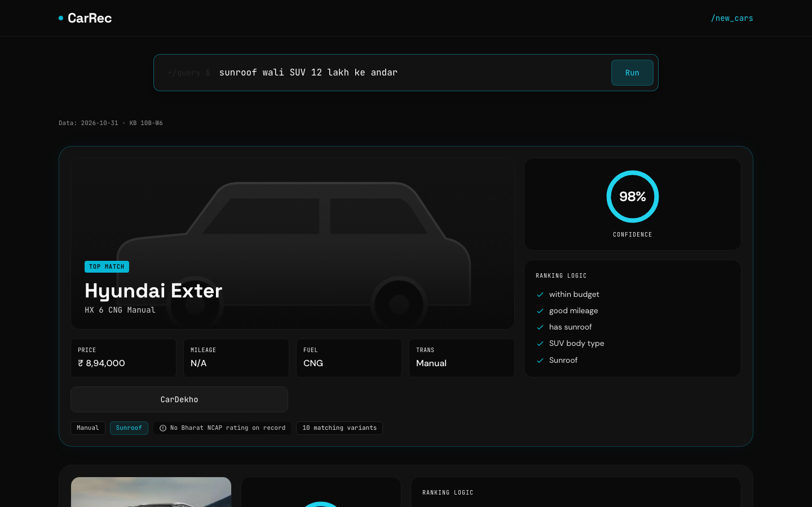

# Smart Car Recommendation Engine (CarRec)

A Flask app that turns a plain-language car query, in English or Hinglish, into recommendations for new cars currently on sale in India.

**Live demo: https://carrec.onrender.com/**

The demo runs on Render's free tier, which sleeps when idle, so the first load can take about a minute.



## What it does

Type what you want. CarRec reads the budget, body type, fuel, gearbox, seats, features, brands and exclusions, filters the catalogue, and returns the best variant of up to 8 models. Each result explains why it matched.

Example queries:

- `sunroof wali SUV 12 lakh ke andar`
- `petrol SUV under 15 lakh`
- `automatic but not AMT`
- `something like Creta`

## Highlights

- **Exact transmission types.** Every result shows its gearbox: manual, iMT, AMT, DCT, CVT, e-CVT, torque converter or single-speed EV. A query like "automatic but not AMT" leaves out AMTs and keeps every other automatic.
- **"Unverified" instead of guessing.** If a requested feature or minimum is unknown for a car, the car stays in the results, labelled "Unverified: …". Cars known to lack it are removed.
- **Bharat NCAP ratings.** Safety stars come only from Bharat NCAP. Unrated cars say "No Bharat NCAP rating on record" and are never shown as zero stars.
- **Hints when nothing matches.** An empty result lists up to 3 requirements you could drop, with how many models each would bring back.

## Data

The catalogue (`data/catalogue.csv`) has 832 variants of 62 models from 12 brands. It was exported on 2026-10-31 from knowledge-base phase 10B-W6. The knowledge base is maintained separately and tracks where each value came from. It is not in this repository; only the exported catalogue is.

## Evaluation

Results were checked against a research query set and its feasibility oracle: 213 phrasings plus 28 end-to-end queries, 241 in total. There were 0 hard-constraint violations and 0 false empties (no results returned when matching cars existed).

The oracle checks budget, fuel, transmission family (manual/automatic), body type and seats only. Features, exact transmission types, safety stars, other minimums, brands, models and exclusions are covered by unit and end-to-end tests instead.

## Limitations

- 12 brands only: Honda, Hyundai, Kia, MG, Mahindra, Maruti Suzuki, Nissan, Renault, Skoda, Tata, Toyota, Volkswagen.
- 22 of 62 models have a real photo. The rest, including every Maruti Suzuki, show a body-type silhouette.
- Mileage is unknown for about 40% of non-EV variants: 336 of 795 have no ARAI kmpl figure, and 299 have no mileage figure at all. Mileage minimums keep these cars, labelled "Unverified: mileage".
- Safety stars come only from Bharat NCAP: 20 models / 363 variants are rated. Older Global NCAP ratings are not used.
- Used-car search is off in the demo. It needs Selenium and headless Chrome and is enabled only with `ENABLE_USED_CARS=1`.

## Run locally

The production code is on the `deploy/new-car-v1` branch. Python 3.12:

```bash
git clone -b deploy/new-car-v1 https://github.com/ShaikYaseenBasha578/Smart-Car-Recommendation-Engine.git
```

```bash
cd Smart-Car-Recommendation-Engine
```

```bash
python3 -m venv .venv && source .venv/bin/activate
```

```bash
pip install -r requirements.txt
```

```bash
python app.py
```

Then open http://127.0.0.1:5001.

`DATA_SOURCE` picks the data path: `kb` (default) uses `data/catalogue.csv`; `legacy` uses the older 2021-era dataset in `car_recommendation_assets/`.

## Tech stack

Flask, pandas, scikit-learn, gunicorn, hosted on Render.

## Branches

- `deploy/new-car-v1`: the production code that Render deploys.
- `main`: this README, plus older code and the earlier data-enrichment tooling in `scraping/` and `datasets/`.
