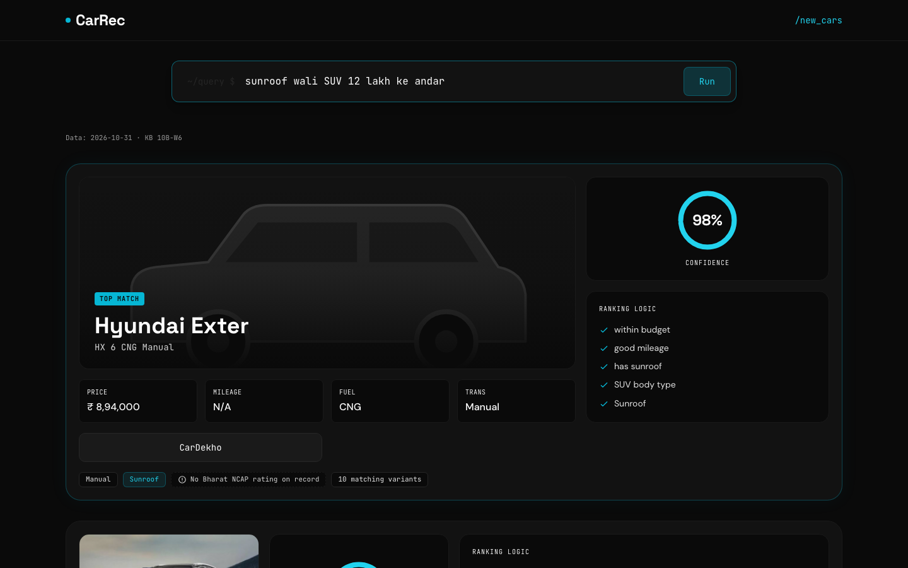

# Smart Car Recommendation Engine (CarRec)

A Flask app that turns a plain-language car query, in English or Hinglish, into recommendations for new cars currently on sale in India. Every number it shows comes from a source-tracked knowledge base, and every result says why it was picked and what is still unknown.

**Live demo: https://carrec.onrender.com/**

The demo runs on Render's free tier, which sleeps when idle, so the first load can take about a minute.



## What it does

Type what you want. CarRec reads the budget, body type, fuel, gearbox, seats, features, minimums, brands and exclusions. It keeps only the cars that meet every hard requirement, scores them, and returns the best variant of up to 8 different models. Each card explains the choice using only the numbers the score used.

Example queries:

- `sunroof wali SUV 12 lakh ke andar`
- `petrol SUV under 15 lakh`
- `automatic but not AMT`
- `EV with at least 400 km range under 25 lakh`
- `something like Creta`

## Highlights

- **Ranking engine v3** (`services/recsys/`): the query is parsed, the catalogue filtered on the hard requirements, and each car scored on three kinds of evidence: specifications, expert reviews and owner ratings. Review weights scale with how much evidence a car has, so a car with few reviews is neither rewarded nor punished for it. Results are spread across models: one variant per model, then maximal marginal relevance. Design: [`docs/RECOMMENDER_DESIGN_PLAN.md`](docs/RECOMMENDER_DESIGN_PLAN.md).
- **Explanations from the score itself.** Each reason is tied to the catalogue columns or review criteria behind it, with a source link where there is one. Unknowns are listed plainly.
- **"Unverified" instead of guessing.** If a requested feature or minimum is unknown for a car, the car can still appear, labelled "Unverified: …". Cars known to lack it are removed.
- **Named relaxations when nothing fits.** If no car meets every requirement, the engine finds the smallest named change that gives results (for example "budget +10%" or "any automatic instead of DCT") and says which one it used.
- **Exact transmission types.** Manual, iMT, AMT, DCT, CVT, e-CVT, torque converter or single-speed EV. "Automatic but not AMT" keeps every other automatic.
- **Bharat NCAP ratings only.** Unrated cars say "No Bharat NCAP rating on record" and are never shown as zero stars.
- **Car pages.** `/car/<make>/<model>` shows a model's variants, specifications and review evidence with sources.
- **Optional LLM parser.** Off by default. When on, it may only add requirements whose wording it quotes from the query; any failure falls back to the rule parser.

## Data

The default catalogue (`data/catalogue_v3/catalogue.csv`) has **1,556 variants of 101 models from 12 brands**, exported on 2026-11-21 from the CarRec knowledge base. Variants with no known price are left out (63 in this export) and listed in `catalogue_meta.json`, which also records the export time, the knowledge-base hash and the coverage of each column. Review evidence sits beside it: `data/assessments.csv` (Autocar India expert reviews, 85 models) and `data/owner_ratings.csv` (CarWale owner ratings, 97 models).

The knowledge base is an SQLite database of variants, specifications, prices, crash tests and reviews. Every value keeps its source and its evidence class. A value is written only when two sites agree or the maker's brochure confirms it, and for specifications the brochure wins over the sites. Wrong values are quarantined, not deleted.

It is maintained by `kbpipe`, a rerunnable pipeline (`./bin/kbpipe update`). The pipeline reads CarWale and CarDekho, the OEM brochures on disk and the review sources, re-checks the values it changed against their sources, exports the catalogue into this repository, runs the tests and the evaluation, and opens a pull request. The database file itself is not in git; the pipeline code lives on the `kb/*` branches.

The original 832-variant, 62-model catalogue (`data/catalogue.csv`) is kept and selected with `CARREC_CATALOGUE_DIR=data`.

## Evaluation

`eval/run_eval.py` runs the engine on two query sets and checks every returned car against the query's hard requirements (budget, fuel, gearbox, body type, seats, features and minimums):

| Query set | Queries | Answered with cars | No requirement violated | Every requirement verified |
|---|---|---|---|---|
| Main (`eval/queries.jsonl`) | 209 | 193 | 193 (100%) | 181 (94%) |
| Held-out (`eval/heldout_queries.jsonl`) | 120 | 107 | 105 (98%) | 91 (85%) |

"Verified" is the stricter measure: a car whose value is unknown for a hard requirement counts as not satisfied. The two held-out violations are sedans outside an "around 12 lakh" budget and non-hybrid cars returned for a hybrid query. On the 40 main queries with a hand-made shortlist, recall at 8 is 0.745 and MRR is 0.789. These figures are for the 1,556-variant catalogue; earlier runs are in `eval/results/`.

## Limitations

- 12 brands only: Honda, Hyundai, Kia, MG, Mahindra, Maruti Suzuki, Nissan, Renault, Skoda, Tata, Toyota, Volkswagen.
- 88 of 101 models have a photo from an OEM brochure, captioned with its source (`data/image_manifest.csv`). The other 13 show a body-type silhouette: Bolero Neo Plus, Camry, Creta Electric, Fortuner Legender, Hector Plus, Invicto, Syros EV, Tekton, Thar Roxx, Tigor EV, Urban Cruiser Ebella, XUV 3XO EV and XUV400. Brochure images are not licensed for reuse.
- Mileage is unknown for about half of the petrol, diesel and hybrid variants: 688 of 1,296 have no ARAI kmpl figure. Mileage minimums keep these cars, labelled "Unverified: mileage".
- Bharat NCAP ratings cover 26 models (654 variants). Older Global NCAP ratings are not used.
- Prices are ex-showroom figures from the listing sites on the export date and can lag the market.
- Used-car search is off in the demo. It needs Selenium and headless Chrome and is enabled only with `ENABLE_USED_CARS=1`.

## Run locally

Python 3.12:

```bash
git clone https://github.com/ShaikYaseenBasha578/Smart-Car-Recommendation-Engine.git
```

```bash
cd Smart-Car-Recommendation-Engine
```

```bash
python3 -m venv .venv && source .venv/bin/activate
```

```bash
pip install -r requirements.txt
```

```bash
python app.py
```

Then open http://127.0.0.1:5001.

Run the tests (always the `tests/` directory, never the repository root):

```bash
python -m pytest tests -q
```

### Options

| To get | Set |
|---|---|
| the old ranking engine (on whichever catalogue is selected) | `RANKER=current` |
| the original 832-variant catalogue | `CARREC_CATALOGUE_DIR=data` |
| the 2021-era legacy dataset and code path | `DATA_SOURCE=legacy` |
| the optional LLM parser | `LLM_PARSER=on`, with a key in `GEMINI_API_KEY` |

Keys are read from the environment only.

## API

A small typed FastAPI service (`api_service/`) exposes the same engine through `GET /health` and `POST /v1/recommend`. Running it, the Docker setup and CI are described in [`docs/API_AND_DEPLOY.md`](docs/API_AND_DEPLOY.md).

## How it works pages

The site serves four explainer pages: `/project` (overview), `/project/pipeline`, `/project/knowledge-base` and `/project/engine`. They live in `project_pages/` and the KB pipeline regenerates them on each update. To refresh them by hand:

```bash
.venv/bin/python scripts/sync_project_pages.py --src <folder with index.html, pipeline.html, kb.html, engine.html>
```

## Tech stack

Flask, pandas, scikit-learn, FastAPI, gunicorn, Docker and GitHub Actions, hosted on Render.

## Branches

- `main`: the production code. Render deploys it on every merge.
- `data/kb-update-<date>`: catalogue updates opened by the KB pipeline, one pull request per update.
- `kb/*` and `paper/v0`: the knowledge-base pipeline and the research paper.
- `deploy/new-car-v1`: the previous deploy branch, kept as a rollback reference.
